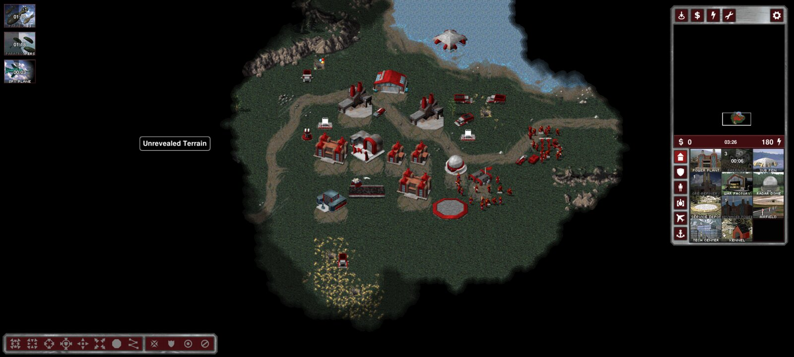
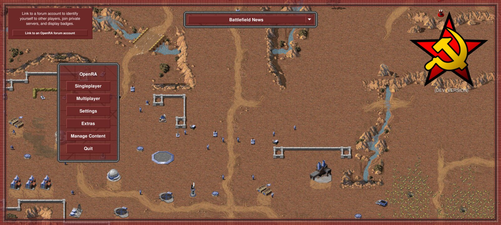
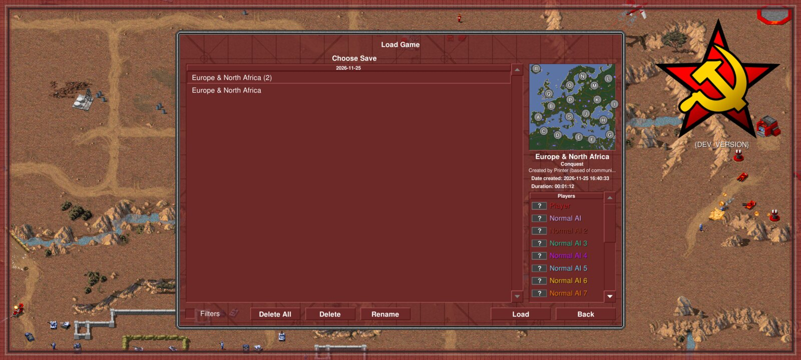

<div align="center">

# AndroidRA

**Classic Command & Conquer real-time strategy on your Android phone.**

An unofficial Android port of the [OpenRA](https://www.openra.net) engine with touch controls,
an on-screen keyboard and support for phones and tablets.




</div>

## Features

- 🎮 **Three classic games**: Command & Conquer: Red Alert, Tiberian Dawn and Dune 2000, based on OpenRA.
- 👆 **Touch controls** designed for RTS: tap to select and command, drag for a selection box,
  two fingers to scroll the map, pinch to zoom.
- ⌨️ **On-screen keyboard** for player names, chat and save games.
- 📱 **Adapts to the screen**: full-screen rendering and automatic UI scaling for high-density displays.
- 🤖 **Skirmish against AI**, missions, saved games, replays and custom maps.
- 🌐 **Multiplayer** online and over LAN with other players running the same AndroidRA build.
- 📦 **No game files included**: the original content is downloaded in-game from the freeware release.

## Screenshots

| Main menu | Saved games |
|---|---|
|  |  |

## Installation

1. Download the latest `AndroidRA-<version>-arm64.apk` from the [Releases](../../releases) page.
2. Open it on your phone and allow installing apps from this source when Android asks.
3. Start **AndroidRA** and choose **Quick Install** to download the game content (about 20 MB).

**Requirements:** Android 7.0 or newer, a 64-bit ARM processor (almost every phone from the last few years)
and OpenGL ES 3.0.

## Controls

| Gesture | Action |
|---|---|
| Tap | Select units, give orders, press buttons |
| Double tap | Select all units of the same type |
| Drag with one finger | Selection box, scroll lists |
| Drag with two fingers | Scroll the map |
| Pinch | Zoom in and out |
| Long press or two-finger tap | Deselect, pause or cancel production |
| Back button | In-game menu |

## Custom maps

Copy `.oramap` files to `Android/data/pl.androidra/files/maps/ra/{DEV_VERSION}/` on your phone
(over USB, or with `adb push`) and restart the game. Maps must be made for Red Alert.

## Building from source

The app is built on Linux with .NET 10, the Android SDK/NDK and JDK 17:

```bash
./packaging/android/build-native.sh   # SDL2, OpenAL Soft, FreeType and Lua for Android
./packaging/android/build-apk.sh      # builds the APK
```

See [OpenRA.Android/README.md](OpenRA.Android/README.md) for the full setup, signing and known limitations.

<details>
<summary>Repository layout</summary>

| Path | Contents |
|---|---|
| `OpenRA.Android/` | The Android app: launcher, manifest and native glue |
| `packaging/android/` | Scripts that build the native libraries and the APK |
| `OpenRA.Game/`, `OpenRA.Platforms.Default/` | The OpenRA engine, with the changes needed for Android |
| `OpenRA.Mods.*/`, `mods/`, `glsl/` | Game rules, mods and shaders |
| `OpenRA.Test/` | Engine unit tests (`dotnet test OpenRA.Test/OpenRA.Test.csproj`) |

</details>

## Credits and license

AndroidRA is built on [OpenRA](https://github.com/OpenRA/OpenRA), created by the OpenRA developers and
contributors listed in [AUTHORS](AUTHORS). AndroidRA is not made or endorsed by the OpenRA project; please
report problems with this port here.

AndroidRA is free software released under the [GNU General Public License v3](COPYING). Third-party
libraries bundled with the app are listed in
[THIRD-PARTY-NOTICES.md](OpenRA.Android/THIRD-PARTY-NOTICES.md).

EA has not endorsed and does not support this product. Command & Conquer and Red Alert are trademarks of
Electronic Arts.
